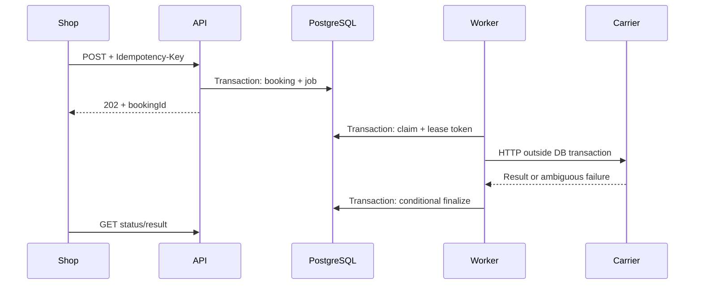

# Delivery Booking API

Connector between a shop and two fictional carriers. The shop submits a shipment
and polls for a confirmed tracking number. The interesting case is an external
success followed by a lost response or a crashed worker.

Java 25, Spring Boot 4.1.1, Spring Data JPA, PostgreSQL 16, Flyway, Lombok,
Maven Wrapper, Testcontainers and Micrometer.

Maven coordinates: com.company:delivery-booking-api. Java package root: com.company.delivery.

## Source layout

Packages under `src/main/java/com/company/delivery` group classes by responsibility:

| Package | Responsibility |
| --- | --- |
| `controller` | HTTP endpoints and exception-to-response mapping |
| `service` | Booking use cases, carrier selection, dispatch and retry decisions |
| `repository` | Persistence, job claiming and transactional completion |
| `dto` | Booking request and response records |
| `model` | Booking entity, statuses, carriers and dispatch state records |
| `client` | Carrier HTTP integrations, shared HTTP helper and carrier outcomes |
| `config` | Carrier and worker configuration properties |
| `scheduler` | Scheduling and per-carrier concurrency limits |
| `metrics` | Queue gauges |
| `filter` | API request logging and request IDs |
| `exception` | Application errors |

`DeliveryApplication` remains in the root package so component, entity, repository
and configuration-property scanning cover all subpackages. Tests mirror these
packages; shared fixtures and the carrier stub live in test-only `support`.

## Run in five minutes

Requires Docker Compose; the optional demo script also needs Python 3. The first
build downloads a JDK image and dependencies. The API can also be exercised with curl.

```sh
docker compose --profile application up --build -d --scale worker=2
python3 scripts/demo.py
```

Crash demo: temporarily reduce the pool to one worker, kill it after the external
effect, then start two workers and recover the result:

```sh
python3 scripts/demo.py --crash
```

API: http://localhost:8080.
Metrics: http://localhost:8080/actuator/prometheus.
Readiness: http://localhost:8080/actuator/health/readiness.

Stop without deleting data:

```sh
docker compose --profile application down
```

All published ports bind to loopback. Simulator admin endpoints are local test
tools. There are no real courier accounts or credentials.

### Maven / IDE

Requires JDK 25 and Docker. Spring Boot starts PostgreSQL and the simulators:

```sh
./mvnw spring-boot:run -Dspring-boot.run.profiles=local
```

Default role: API and worker. Profile api disables the worker. Profile worker
disables the booking controller but retains Actuator. Do not run Maven and the
full Compose stack simultaneously on the same ports.

## Verify

```sh
./mvnw verify
```

Unit tests run in Surefire; *IT tests run in Failsafe on real PostgreSQL containers.
Missing Docker fails integration tests. Tests use ephemeral ports/databases.
Reports: target/surefire-reports, target/failsafe-reports and
target/site/jacoco/index.html.

Docker image packaging skips tests; verify is the quality gate locally and in CI.
The included GitHub Actions workflow requires a push to execute remotely.

## API example

```sh
curl -i http://localhost:8080/api/v1/bookings \
  -H 'Content-Type: application/json' \
  -H 'Idempotency-Key: example-package-1' \
  -d '{
    "orderReference":"ORDER-123",
    "sender":{"country":"PL","city":"Warsaw","postalCode":"00-001","street":"Example 1"},
    "recipient":{"country":"DE","city":"Berlin","postalCode":"10115","street":"Example 2"},
    "weightGrams":1234,
    "serviceType":"STANDARD"
  }'
```

| Operation | Result |
|---|---|
| POST /api/v1/bookings | 202 + Location and booking status |
| GET /api/v1/bookings/{id} | 200 status; 404 unknown |
| GET /api/v1/bookings/{id}/result | 200 tracking/label URL; 409 not confirmed |

Same key + same DTO returns the same booking, even after completion (202).
Same key + different DTO returns 409. JSON property order is irrelevant; country
codes are normalized. Other strings remain exact: whitespace changes count as
different data. Keys remain stored with bookings. orderReference is not unique:
one order can contain several parcels. Invalid fields return 400; unsupported
routes return 422. Errors use ProblemDetail.

STANDARD and EXPRESS delivery are supported by both carriers on the same routes
and weight limits. EXPRESS is sent to the carrier as a delivery product; it does
not change worker scheduling priority. For an express shipment use
`"serviceType":"EXPRESS"` and a new idempotency key. The demo covers both services.

## Routing and states

Shipments originate in PL. Alpha serves PL up to 10kg; Beta serves PL/DE up to 30kg.
Alpha wins when both match. Carrier and routing version are fixed at acceptance.

| State | Meaning |
|---|---|
| ACCEPTED | Durable request waiting for work |
| PROCESSING | Creating a shipment |
| RETRY_SCHEDULED | A permitted create retry is scheduled |
| RECONCILING | Looking up an uncertain outcome |
| BOOKED | Confirmed result |
| REJECTED | Definitive business rejection |
| FAILED | Finished without evidence of a possible external effect |
| REQUIRES_RECONCILIATION | Unknown result needs operator attention |

Alpha deduplicates create by booking UUID (24h contract). Beta has no create
deduplication: an ambiguous create is followed only by lookup. Lookup may lag;
404 is not proof that the previous create did not happen.
### Fictional carrier contracts

Both accept shipments originating in Poland. Alpha serves PL up to 10kg;
Beta serves PL/DE up to 30kg. Requests and responses are mapped in the adapters.

Alpha: POST /shipments, Idempotency-Key = booking UUID. The same key creates one
shipment, including concurrent retries, retained for 24h. GET /shipments/by-reference/{id}.
Fields: clientReference, sender, recipient, weightGrams, serviceType (STANDARD or EXPRESS). Result: trackingNumber, labelUrl.

Beta: POST /consignments; no create deduplication. GET /consignments?reference={id}.
Fields: reference, origin, destination, massKg, serviceLevel (REGULAR for STANDARD, PRIORITY for EXPRESS). Result: number, document.
Lookup can lag behind writes. A missing result never proves that an earlier create failed.

Both: 422 is definitive rejection, 429 guarantees no effect and includes Retry-After;
401/403 means invalid configuration. 5xx, timeouts and malformed success are ambiguous.
Only the trusted fictional API's result URLs are returned; the connector never fetches them.

The application retry horizon must remain below Alpha's 24h idempotency retention.

## Architecture



Spring Data JPA handles reads. A small explicit SQL repository implements
PostgreSQL SKIP LOCKED and ownership updates. No transaction spans HTTP.

Claims last 30s by default. A replacement worker changes the ownership token;
a stale worker cannot overwrite the result. The token does not cancel HTTP already
sent. Expired leases therefore trigger lookup.

Retries use exponential backoff with jitter, respect Retry-After and stop at five
attempts per operation or a 1h age limit. An uncertainty flag survives subsequent
errors, so a later rate limit is not mistaken for proof of no earlier effect.
No automatic provider failover after ambiguity. No end-to-end exactly-once claim.

## Scaling and configuration

```sh
docker compose --profile application up -d --scale worker=2
```

API is stateless. Worker capacity is two in-flight operations **per carrier per
replica**. Each carrier has its own slots. Claims happen inside those slots, not
far in advance. Scaling increases combined provider traffic; there is no global
rate limiter. Use at most two workers in the demo unless deliberately testing higher
concurrency. Throughput has not been benchmarked.

| Setting | Default |
|---|---|
| delivery.worker.concurrency | 2 per carrier per replica |
| delivery.worker.poll-delay | 500 ms |
| delivery.worker.lease | 30s |
| delivery.worker.max-attempts | 5 per operation |
| delivery.worker.max-age | 1h |
| delivery.worker.initial-backoff / max-backoff | 1s / 30s |
| delivery.carriers.connect-timeout / request-timeout | 2s / 5s |

Retry age is validated to at most 23h, below Alpha's key retention. Lease must exceed
the HTTP timeout budget. The DB clock governs ownership; age checks use application
UTC time, so production hosts need synchronized clocks.

`@Observed` on `BookingService.submit/get/result` adds timers
`delivery.booking.submit`, `delivery.booking.status` and `delivery.booking.result`.
They record method call counts, duration and exceptions. These method timings are
separate from the asynchronous end-to-end booking duration. Annotation support is
enabled with `management.observations.annotations.enabled` and the AspectJ starter.
No tracing exporter is configured; observations currently feed metrics only.

Metrics cover attempts, HTTP latency, booking latency, queue size/age, expired
leases and manual reconciliation. Queue gauges describe the global database:
use max across replicas, not sum. Logs exclude addresses, payloads and label URLs.

`delivery.queue.ready` counts READY jobs due for execution now or overdue;
`delivery.queue.scheduled` counts READY jobs waiting for a future attempt time.
Both use the database clock and exclude RUNNING and DONE jobs. Prometheus exposes
them as `delivery_queue_ready` and `delivery_queue_scheduled`.

Unexpected worker exceptions increment `delivery.worker.errors` with bounded
`carrier`, `operation` and `stage` tags (`CLAIM`, `CHECK_BUDGET`, `CARRIER_CALL`,
`DECIDE`, `COMPLETE`). Claim errors use operation `NONE`. Carrier timers record
`outcome=ERROR` if a client unexpectedly throws; failures after a successful carrier
call retain its successful HTTP outcome. Error logs include booking and attempt
IDs when a job has been claimed, exception type and up to five application stack
locations. Exception messages, causes and payloads are excluded. The error handler
does not finalize or retry the job; unfinished work remains available for lease recovery.

## Application logs

Console logs use a plain-text pattern: ISO timestamp in UTC, level, thread, logger
class, requestId, message with named parameters. Compose uses this same format for
API and workers. JSON ECS output is not enabled by default.

API INFO events show accepted bookings (only after commit), idempotent replays,
conflicts, status/result reads and validation failures. Each /api/ request logs its
method, route template, HTTP status and duration. The server generates X-Request-ID
and returns it in the response; this ID correlates logs within a request.
bookingId links API events with worker attempts across separate processes.

Workers log the beginning and end of each attempt, carrier, operation, result,
next action and retry delay. No request bodies, address data, idempotency keys,
tracking numbers or label URLs are logged. Actuator probes are excluded from the
API request log. Polling status produces INFO entries intentionally for the demo.

```sh
docker compose --profile application logs -f api worker
```

## Review and limitations

The current implementation is presented as eight reconstructed review stages:

1. Java 25, Spring Boot, PostgreSQL and Flyway bootstrap.
2. Validated booking API, carrier selection and transactional idempotency.
3. Carrier adapters and persistent local simulators.
4. Job leases, attempt history, invalid-payload quarantine and ownership checks.
5. Worker concurrency, bounded retries and recovery of uncertain results.
6. Queue metrics and correlated request logging.
7. Docker Compose deployment and CI verification.
8. Executable demo and this self-contained README.

Every commit was checked with `./mvnw clean verify`. The final snapshot contains
87 passing tests (57 unit and 30 integration); remote CI and production load tests
have not been run.

Suggested review order: `BookingService.submit`, `AlphaClient` / `BetaClient`,
`JobRepository.claim` / `complete`, `RetryPolicy`, then `RecoveryIT`.

### Operating the service

- Increasing ready-job count: check workers, carrier latency and the DB connection
  pool. Scheduled jobs may be correctly waiting for backoff or Retry-After.
- Unknown outcome: find the booking and attempt IDs in logs and query the carrier
  by booking UUID. A missing Beta result does not justify another CREATE or a
  switch to another carrier. There is no administrative resolution endpoint.
- Expired leases: check process crashes, JVM pauses and HTTP timeout settings.
  An ownership token protects DB writes but cannot cancel an external request.
- An invalid stored payload is removed from automatic processing with
  `INVALID_STORED_PAYLOAD`; uncertain external effects require reconciliation.
- Liveness describes process health; readiness also checks the database. A carrier
  outage does not fail liveness. Queue gauges query the DB at scrape time, so large
  histories require retention and measured query costs.
- Counters are operational signals rather than an accounting ledger: a process
  can stop between a DB commit and metric emission.

The demo has one logical customer and no authentication/manual resolution API.
Production needs tenant isolation, sensitive-data retention, secrets, backup/restore,
global quotas and operational ownership. Label URLs are examples, not real documents.

PostgreSQL polling keeps the scope small. Larger volumes may warrant a broker and
transactional outbox; neither resolves an ambiguous external HTTP effect.

This implementation used Codex assistance. Candidate review and understanding are
required before recruitment submission.
